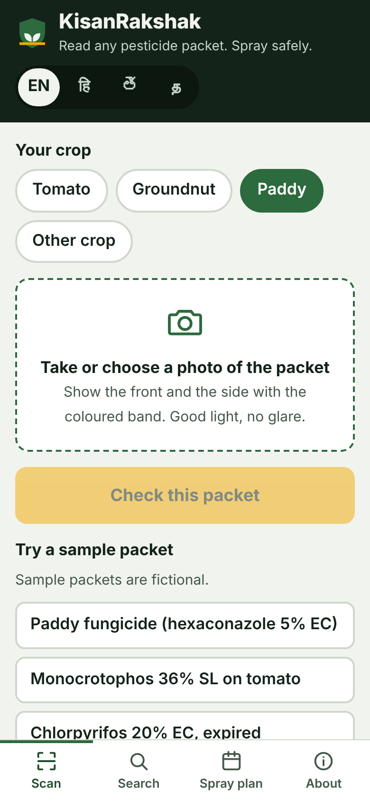
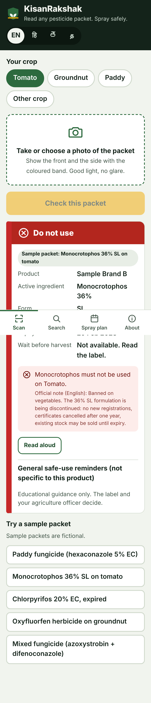
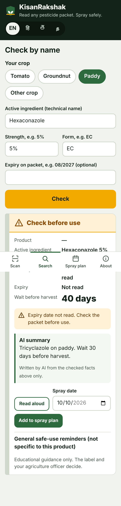
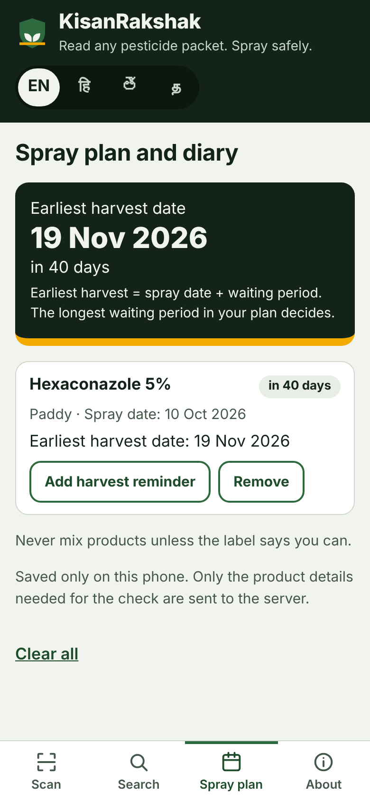

# SprayWise

**An AI pesticide-packet reader and safe-use guide for small farmers, in English, Hindi, Telugu and Tamil.**

Built for the SITAMS x HackSphere AI Hackathon, domain **AI for Agriculture**.

A farmer photographs a pesticide packet. SprayWise reads it, checks it against the official Indian banned and restricted lists, tells the farmer how many days to wait before harvest, warns about expired packets, and keeps a spray diary that works out the earliest harvest date across everything sprayed.

> Educational guidance only. It does not replace the packet label, a licensed dealer or an agriculture officer.

| Scan a packet | Banned on this crop | Check by name | Spray plan |
|---|---|---|---|
|  |  |  |  |

## The problem

Pesticide labels are small, technical and mostly in English or Hindi. The people who spray are often not told what the label says.

- Pesticide poisoning is a documented farm-safety problem. Down To Earth reported that Maharashtra told the Lok Sabha pesticides killed 272 farmers in the state over four years, including 21 in Yavatmal in 2017 ([source](https://www.downtoearth.org.in/agriculture/death-by-pesticides-farmers-continue-to-die-as-india-flouts-global-norms-59830)).
- The same article cites a PAN India study (Yavatmal, October 2017): dealers were unaware of, or feigned ignorance of, approved uses and waiting periods, and bottles and packets often lack approved uses, doses and waiting times, pointing instead to a leaflet farmers typically never receive.
- The rules also move. In 2023 the government omitted label claims for several products on specific crops (for example oxyfluorfen on groundnut and malathion on tomato) ([Insecticides (Prohibition) Order 2023](https://www.legitquest.com/act/insecticides-prohibition-order-2023/E1BF)). A farmer cannot tell this from a packet.

**Existing tools.** Crop-doctor apps such as [Plantix](https://www.gsma.com/solutions-and-impact/connectivity-for-good/mobile-for-development/programme/agritech/detecting-and-managing-crop-pests-and-diseases-with-ai-insights-from-plantix/) diagnose what is wrong with a crop and are available in 20 languages. Their published descriptions do not mention reading the pesticide packet or giving product-level safety and waiting-period guidance. SprayWise works on the other side of the problem: *the thing the farmer is about to spray.*

## What it does

1. **Reads the packet** from a photo (vision AI): ingredient, strength, form, toxicity colour band, registration number, batch, expiry, crops and waiting period printed on it. The user confirms/corrects the extracted ingredient, strength and form before the reference check runs.
2. **Checks bans and restrictions** against 95 entries from the official lists, including crop-specific restrictions. Monocrotophos on tomato and oxyfluorfen on groundnut are flagged, but not on crops where they are still allowed.
3. **Waiting period before harvest** for 30 products on tomato, groundnut and paddy. It never borrows a value from a different strength or form. If reference and label disagree it uses the longer one. Unknown products/crops are explicitly marked unverified, never treated as approved.
4. **Expiry check** in code, not by the AI.
5. **Toxicity colour band**, the red / yellow / blue / green mark printed on Indian packets ([Insecticides Rules, 1971](https://en.wikipedia.org/wiki/Toxicity_label)), explained in words.
6. **Spray plan and diary.** Add products with the spray date. It computes the earliest harvest date across all products (the longest waiting period wins), warns when two products share an active ingredient (overdose risk), and exports a calendar reminder (.ics). Saved on the phone only.
7. **Four languages** for every screen, alert and spoken result (read aloud uses the phone's voices).
8. **Works without a packet.** Fictional sample packets and a search-by-name form run on the same engine, with no API key needed. The app also opens offline as an installable web app.

## How the AI is kept honest

The language model does **two small jobs** and never decides a safety fact.

```
photo ──► vision model reads the printed fields (JSON, bounded, sanitised)
              │
              ▼
        rules engine (plain Python, tested)  ◄── data/pesticides.json, data/banned.json
   banned? restricted for this crop? waiting days? expired? duplicate ingredient?
              │
              ▼
   result card in 4 languages (fixed, translated templates)
              │
              ▼ optional
   AI summary ── rejected if it contains any number that is not in the checked facts
```

- Text on a packet is treated as data. The prompt tells the model to ignore instructions printed on it, and its output is cut to a fixed schema and length.
- Unknown means unknown. A missing value shows "read the label". The app never says a product is "safe", only "no ban found, still follow the label".
- A product that is not in the reference file is reported as *not covered*, not as approved.
- Exact reference and crop matches are kept separate from product registration or safety; absence of a ban is never treated as proof of approval.
- The About screen lists source dates and known coverage gaps. Curated data is not bulk-expanded without manual verification against authoritative sources.
- The AI summary is optional and is dropped unless every number in it appears in the checked facts.

## Tech stack

| Layer | Choice |
|---|---|
| Frontend | Plain HTML, CSS and JavaScript, mobile first, no framework, service worker for offline shell |
| Backend | Python 3.12, FastAPI, one service that also serves the frontend |
| AI | Google Gemini vision API (model set by `GOOGLE_GEMINI_MODEL`), called only from the backend |
| Data | Two JSON files with a source on every entry (no database) |
| Hosting | Render free web service (`render.yaml`) |
| Tests | pytest (backend) and a scripted real-browser run (frontend) |

## Run locally

```bash
git clone https://github.com/<you>/spraywise && cd spraywise
python -m venv .venv
# Windows PowerShell: .\.venv\Scripts\Activate.ps1
pip install -r requirements-dev.txt
Copy-Item .env.example .env                               # PowerShell; add your Gemini key to .env
uvicorn app.main:app --reload
# open http://127.0.0.1:8000
```

Without an API key everything works except photo reading: samples, search by name, the plan and all rules still run.

**Check the AI path with your own key before the demo:**

```bash
python scripts/try_photo.py my_packet.jpg paddy
```

### Configuration

| Variable | Default | Purpose |
|---|---|---|
| `GOOGLE_GEMINI_API_KEY` | none | Enables photo reading and AI summaries. Never commit it. |
| `GOOGLE_GEMINI_MODEL` | `gemini-2.5-flash` | Vision model to use |
| `MAX_LLM_CALLS_PER_DAY` | 300 | Hard daily cap so a shared link cannot run up a bill |
| `RATE_ANALYZE_PER_MIN` / `RATE_OTHER_PER_MIN` | 6 / 40 | Per-IP rate limits |
| `MAX_IMAGE_MB` | 5 | Upload limit |
| `ENABLE_EXPLANATION` | true | Turn the AI summary on or off |

## API

| Endpoint | Purpose |
|---|---|
| `GET /api/health` | Status, whether photo reading is on, data counts |
| `POST /api/read-label` | Photo (multipart) → extracted fields for the user to confirm |
| `POST /api/check` | Confirmed scanned fields or manually typed label → rules-based analysis |
| `POST /api/analyze` | Legacy route; returns 409 so clients use the confirmation flow |
| `POST /api/plan` | Spray list → earliest harvest date and duplicate-ingredient warnings |
| `GET /api/samples`, `GET /api/sample/{id}` | Fictional packets for demos |
| `GET /api/meta` | Ingredient suggestions, data sources, known gaps |

## Testing

`python -m pytest` runs the backend and coverage-safety tests, including:

- ban and restriction logic, crop-specific cases, misspelt names, and look-alike ingredients that must not be confused (hexaconazole, tebuconazole, propiconazole)
- waiting periods never borrowed across formulations; combination products never given a single-product value
- expiry parsing for the formats printed on packets, harvest-date and duplicate-ingredient logic
- API errors (non-image, oversize, no key, provider failure, daily budget, rate limit), validation, security headers, no inline scripts
- translations complete in all four languages with identical placeholders; every alert code has text in every language; a scan of the repository for committed keys

The photo call itself is mocked in tests (it needs a paid key). Verify it once with `scripts/try_photo.py`.

**Cross-device checklist** (fill in before submission):

| Check | Result |
|---|---|
| Android phone, Chrome, mobile data: scan a real packet | ☐ |
| Same, in Telugu, with read aloud | ☐ |
| iPhone Safari or a second browser | ☐ |
| Laptop browser | ☐ |
| Airplane mode: the app opens and the diary loads | ☐ |
| Search by name with no photo | ☐ |

## Deploy on Render

1. Push this repository to GitHub.
2. In Render choose **New > Blueprint** and select the repository. It reads `render.yaml`.
3. When asked, set `GOOGLE_GEMINI_API_KEY` in the dashboard. Do not put it in any file.
4. Open `https://<your-service>.onrender.com/api/health`. It should report `"photo_reading": true`.
5. Free instances sleep after inactivity and take up to a minute to wake. Open the link shortly before judging.

## Security and privacy

- No login and no personal data. No farmer name, phone number or location is collected.
- Photos are resized and re-encoded on the phone (this removes EXIF data such as GPS), sent over HTTPS, held in memory for the one request and never written to disk.
- The API key lives only in the host's environment variables. All model calls go through the backend.
- Strict Content Security Policy (no inline script or style), `nosniff`, no referrer, frame blocking. Same-origin only, so no CORS surface.
- Upload checks use the file's real bytes (JPEG, PNG or WebP only) and a size cap. Per-IP rate limits and a daily cap on paid calls.
- The spray diary is stored in the browser (localStorage) only.

## Data and its limits

Reference data was compiled from the Central Insecticides Board & Registration Committee (CIB&RC) "Major Uses of Pesticides" lists and the banned, refused and restricted lists. Every entry carries its source and date. See [`data/`](data) and the `_meta` block in each file.

Please read these limits:

- **30 products on tomato, groundnut and paddy only.** The insecticide list read covers active ingredients A to C. There are no herbicides, because the only herbicide list found was a 2014 edition that still contains banned products.
- **No product safety text is stored.** `safety_notes` is empty by design; the app shows only generic safe-use reminders, labelled as such.
- Values were extracted from the official PDFs with an automated reader and should be spot-checked against the PDF before relying on them.
- The paraquat ban (S.O. 5234(E), 22 Sep 2026) comes from a single trade report and is marked unverified in the data. Confirm it on the PPQS website.
- The banned list was compiled from copies of the official list, because the official page could not be opened. Re-check it against ppqs.gov.in.
- Telugu, Hindi and Tamil text was machine-drafted. Ask a native speaker to review before real-world use.
- Helplines: Kisan Call Centre 1800-180-1551 (6 am to 10 pm, closed Sundays and gazetted holidays) per an [ICAR page](https://dmrsolan.icar.gov.in/html/helpline.html). Emergency number 112.

## AI use disclosure

- **In the product:** a vision model reads the packet photo; an optional model call writes a short summary that is discarded unless it matches the checked facts.
- **In development:** Claude (Anthropic) assisted with research, architecture, code, tests and documentation. The team reviewed and tested the generated code, wrote the safety rules, and is responsible for the submission.

## Hackathon checklist

| Requirement | Where |
|---|---|
| Domain | AI for Agriculture |
| Problem and research | [The problem](#the-problem), [`docs/RESEARCH.md`](docs/RESEARCH.md) |
| SOP | [`docs/SOP.md`](docs/SOP.md) |
| Working project | This repository |
| GitHub and README | You are reading it |
| Deployment | `render.yaml`, steps above |
| Final testing | [Testing](#testing) |

## Licence

MIT. See [LICENSE](LICENSE).
